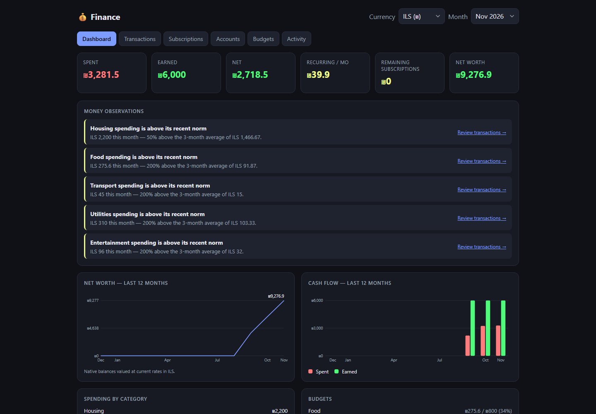
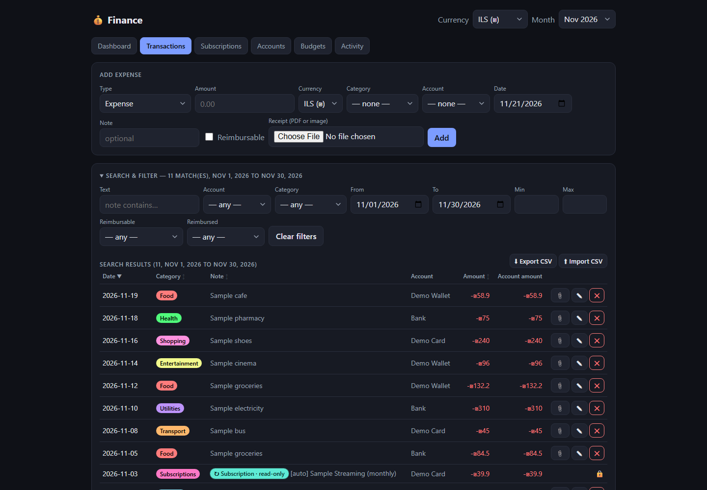

# Finance App

Personal finance tracker — expenses, monthly allowances, and subscriptions
(monthly **and** yearly), with accounts & transfers, per-category budgets
(with optional rollover), savings goals, trend charts, CSV import/export,
and a full activity history with undo.

This is a personal project, built for my own use.




## Stack
- **Next.js 16** (App Router) + **TypeScript**
- **Node 24** (see `.nvmrc`) via **nvm**
- **pnpm** package manager
- Storage: **`node:sqlite`** (the built-in SQLite module in Node 24) — no native build step
- Data file: `data/finance.db` (gitignored)

## Run locally
```bash
nvm use            # picks Node 24 from .nvmrc
pnpm install
pnpm dev           # http://localhost:3000
pnpm test          # Vitest unit, route, and component tests
pnpm test:watch    # Vitest watch mode
pnpm test:coverage # V8 coverage report
# production:
pnpm build && pnpm start
```

## Project layout
- `app/api/*` — JSON API (transactions, subscriptions + charge, accounts,
  transfers, budgets, categories, goals, summary, trends, activity + undo,
  settings, fx, months)
- `app/(finance)/*` — one route per tab (Dashboard / Transactions /
  Subscriptions / Accounts / Budgets / Activity)
- `lib/db.ts` — SQLite schema, additive migrations, seed data
- `lib/validate.ts` — shared request validation used by all POST/PUT routes
- `lib/subscription-due.ts`, `lib/balances.ts`, `lib/csv.ts` — pure logic
  (due dates, balance aggregation, CSV) covered by `tests/`

## Money & FX semantics
Every entry keeps its own currency. When an entry touches an account in a
different currency, the converted value is **snapshotted** at the historical
rate for that date (Frankfurter) and never rewritten. Display totals
(summary, trends, net worth) convert native balances at current rates
(open.er-api.com) into the base currency chosen in the top bar.

## Automatic subscription charging
The systemd user timer `finance-subscriptions-charge.timer` POSTs
`/api/subscriptions/charge` nightly (23:55, `Persistent=true`). Charging is
idempotent (a unique index on `(subscription_id, date)`) and never books a
charge ahead of its due day, in a future month, or before the subscription's
start date. The "Charge now" button on the Subscriptions tab only backfills
the selected month.

## Access boundary
This is a single-user personal app with no built-in authentication yet (see
[#17](https://github.com/darijavan/finance-app/issues/17)), so run it only
behind an authenticating reverse proxy.

## Known dependency advisories
None: on Next 16 with `postcss` overridden to `>=8.5.10` (see
`pnpm-workspace.yaml`), `pnpm audit` is clean.
